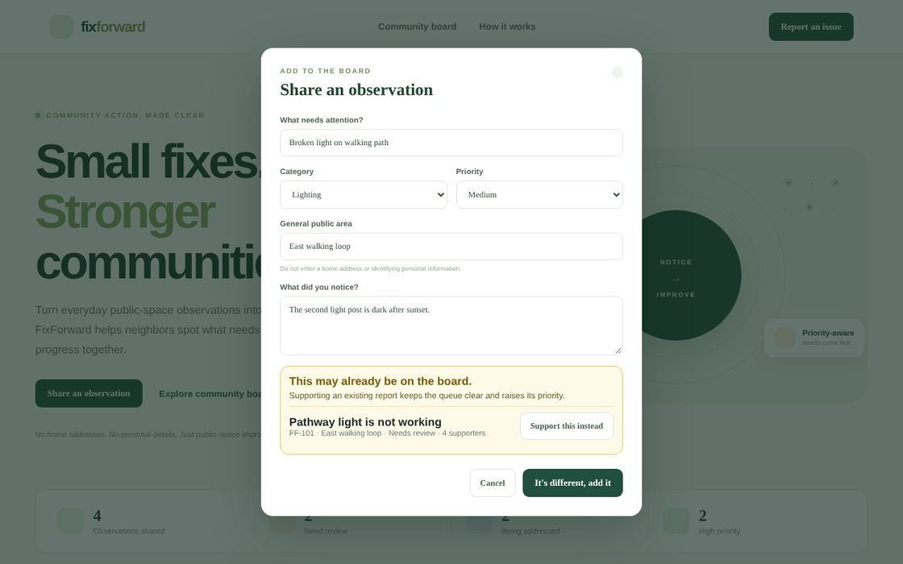

# FixForward — STEMergent Hacks 2026 · version 1.1.0

**Small fixes. Stronger communities.** FixForward is a community-maintenance observation board that helps people turn public-space issues into organized, prioritized follow-up.



## My role & contributions

**Solo developer · AI-assisted**

- Designed the duplicate check that suggests supporting an existing report instead of adding a new one
- Made the priority score explainable, with a point-by-point breakdown

## Competition fit
- **Event:** STEMergent Hacks 2026
- **Pathway:** Hackathon Pathway
- **Eligibility shown on Devpost:** students ages 13+
- **Event window:** October 30–November 15, 2026
- **Submission deadline:** November 15, 2026, 7:00 PM CST (confirm the live countdown/time-zone display before submitting)
- **Team size:** Individual or teams up to four

Official listing: https://stemergent-hacks.devpost.com/  
Official rules: https://stemergent-hacks.devpost.com/rules

## The problem
Small public-space maintenance issues can be hard for a community to communicate clearly and follow from first observation to resolution. Notes may be scattered across conversations, and accessibility-related concerns can be overlooked.

## The solution
FixForward provides a lightweight shared board for recording observations about public spaces, categorizing them, indicating a general location, tracking status, and organizing the queue with a transparent priority heuristic.

## Current prototype features
- Responsive dashboard with seeded fictional demo observations.
- Create an observation with title, category, general public area, description, and severity.
- Input validation and a reminder not to enter home addresses or personal details.
- Search and status filtering.
- Priority and recent sorting.
- Community support votes with a one-vote-per-report-per-browser guard and repeat-vote feedback.
- Demo status updates (moderator control) and status labels.
- Export report data as JSON or CSV. CSV text fields are quoted and spreadsheet formula prefixes are neutralized.
- Local browser persistence via `localStorage`.
- Eight passing Node tests for validation, ID generation, sorting, priority scoring, vote tracking, and defensive stored-data normalization.

## Run locally
Requires Node.js 20.19+ (or Node.js 22+).

```bash
npm install
npm run dev
```

Open the local URL printed by Vite. Run tests with:

```bash
npm test
npm run check
```

Create a production build with:

```bash
npm test
npm run build
```

## Important limitations
- This is a prototype, not a connection to a city or parks department.
- Seeded observations are fictional examples.
- Reports and vote history are stored only in the current browser; there is no shared multi-user database yet. Clearing browser storage or switching browsers resets the vote guard.
- The priority score is an organizational aid, not an official safety assessment or an automated determination of danger.
- Do not use FixForward for emergencies. Contact the appropriate local authority for immediate hazards.
- Avoid entering names, phone numbers, home addresses, or other identifying details.

## Judging alignment
- **Innovation & originality:** combines community observation, accessibility-aware sorting, and transparent status tracking.
- **Problem definition:** focuses on a recognizable gap between noticing a public-space issue and following up.
- **Impact & relevance:** helps communities organize observations about accessibility and maintenance needs.
- **Feasibility & scalability:** can later connect to verified local workflows, moderation, and an opt-in shared database.
- **Presentation:** short report-to-resolution flow is easy to demonstrate.

## Submission checklist
- [ ] Register on Devpost and confirm all team members meet current eligibility requirements.
- [ ] Select the Hackathon Pathway.
- [ ] Publish a repository with source code and this README.
- [ ] Deploy the app and test it on desktop and mobile.
- [ ] Capture screenshots or a short GIF.
- [ ] Record a concise demo video if requested/recommended.
- [ ] Write a project description covering problem, solution, and how it works.
- [ ] Disclose AI tools and all third-party libraries/assets accurately.
- [ ] Confirm the deadline and final submission fields on Devpost.

## Third-party resources
React, Vite, Lucide React, and Google Fonts are third-party dependencies/resources. No external dataset or AI API is used by the running prototype. All sample report content is fictional.

## Verification status

The Node test suite passes (8/8). A Vite production build still needs a fresh dependency install on the target platform; the development workspace could not use the platform-specific Vite native binding from the reference project archive.

See `docs/QA_AND_PRIVACY.md` and `docs/DEMO_SCRIPT.md` for further details.

## License
Permission required: see [License](#license) and `LICENSE`.
